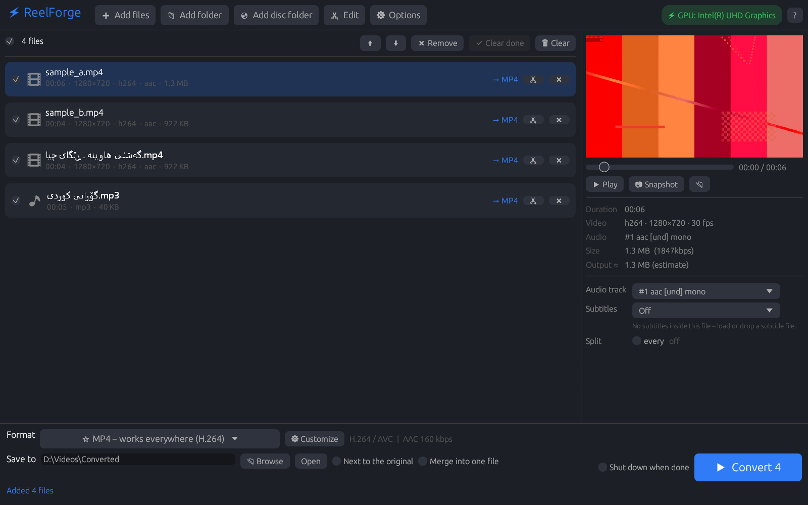
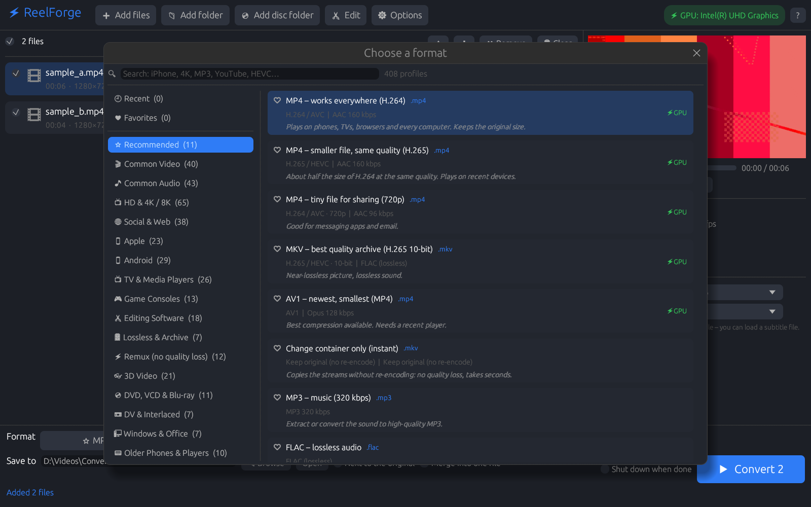
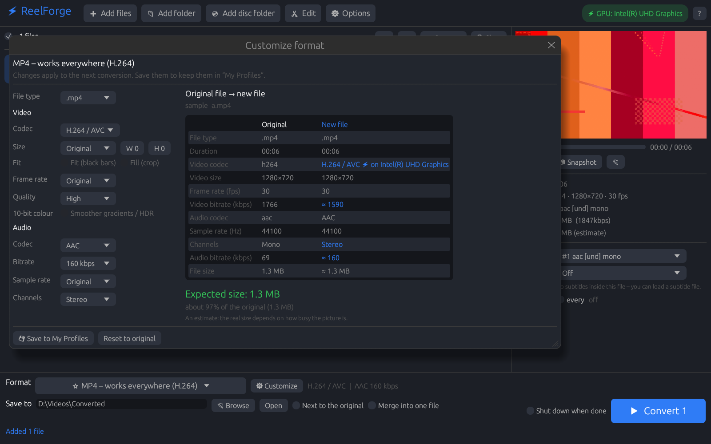
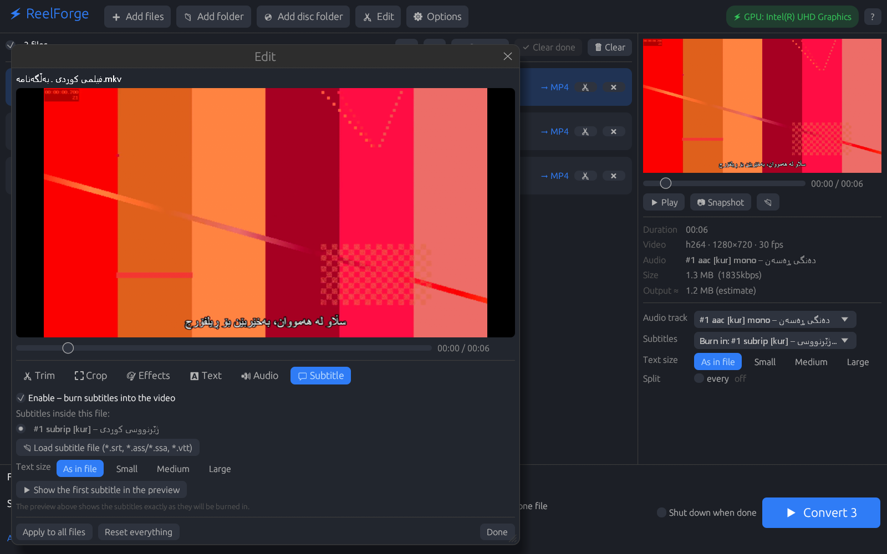

<div align="center">


# ReelForge

### Convert any video or audio, fast. Your graphics card does the heavy lifting.

A friendly, native video and audio converter for Windows, written in **Rust**.
Pick a file, pick one of **409 ready-made profiles**, and press **Convert**.

<p>
  
  
  
  
  
</p>

<p>
  
  
  
  
  
  
</p>

[**Features**](#-features) ·
[**Screenshots**](#%EF%B8%8F-screenshots) ·
[**Download**](#-download) ·
[**Profiles**](#-profile-library) ·
[**Build**](#%EF%B8%8F-build-from-source) ·
[**Changelog**](CHANGELOG.md) ·
[**Developer**](#-developer)



</div>

---

## ✨ Features

<table>
<tr>
<td width="50%" valign="top">

### ⚡ GPU acceleration
- Finds every graphics card Windows reports and **proves each hardware encoder works** with a tiny test encode, so it only offers what actually runs
- **NVIDIA NVENC**, **AMD AMF** and **Intel Quick Sync** for H.264, HEVC and AV1
- **HEVC (H.265)** one click away: about half the size of H.264 at the same quality
- Discrete (external) cards are preferred over integrated ones
- GPU decoding as well as encoding, with automatic fallback to the processor

</td>
<td width="50%" valign="top">

### 🎯 Easy to use
- Drag and drop files, whole folders, a DVD / Blu-ray folder, or a subtitle file onto its video
- One searchable picker: *"iPhone"*, *"4K"*, *"MP3"*, *"YouTube"*…
- Plain-language profile names and descriptions
- **Expected output size** before you convert
- Recent and favourite profiles, plus your own saved profiles
- Right-click menu and keyboard shortcuts for the file list
- Kurdish and Arabic names shown joined and in reading order, as in File Explorer

</td>
</tr>
<tr>
<td valign="top">

### ✂️ Edit before converting
- Trim (drag or type a time such as `1:30`), crop, rotate and flip
- Brightness, contrast and saturation, deinterlace
- Volume and loudness normalising
- Text watermark with position and size
- Subtitles: burn in tracks from the file (text or picture) or load `.srt` / `.ass` / `.ssa` files, with right-to-left script support (Arabic, Kurdish Sorani)

</td>
<td valign="top">

### 🧰 Batch power tools
- Parallel conversions, with a set number of jobs at once
- **Merge** several files into one, or **split** by time
- **Remux** (change container) in seconds with no quality loss
- Pick the audio track, extract audio, take snapshots
- Live progress, speed, time left and the exact FFmpeg command log; progress shows on the taskbar
- *Convert* carries on where it stopped: after a stop or a failed file only the rest is done
- The finish line tells how much space was saved
- A stopped or failed conversion leaves no broken file behind
- *Shut down when done* for long overnight batches

</td>
</tr>
</table>

## 🖼️ Screenshots

<table>
<tr>
<td align="center"><br/><sub><b>Format picker</b>: 409 profiles in 20 categories, searchable</sub></td>
</tr>
<tr>
<td align="center"><br/><sub><b>Customize</b>: codec, size, frame rate, quality and audio, with a before/after table and the expected size</sub></td>
</tr>
<tr>
<td align="center"><br/><sub><b>Edit</b>: subtitles burned in exactly as previewed; Kurdish and Arabic names and titles are drawn joined, in reading order</sub></td>
</tr>
</table>

## ⌨️ Shortcuts

| Key | What it does |
|---|---|
| `Ctrl+O` | Add files |
| `↑` `↓` | Select the previous / next file |
| `Enter` or double-click | Edit the selected file |
| `Delete` | Remove the selected file from the list |
| `Ctrl+A` | Tick all files |
| `Esc` | Close the open window |
| Right-click a file | Menu: edit, play, show in folder, conversion log, remove |

## 📥 Download

Get it from the [**latest release**](https://github.com/zheerkhalid/reelforge/releases/latest):

| File | What it is |
|---|---|
| `ReelForge-Setup.exe` | Installer with Start Menu and desktop shortcuts and an uninstaller |
| `ReelForge-x.y.z-portable-x64.zip` | Portable: unzip and run, nothing is installed |
| `ReelForge.exe` | The bare EXE |

ReelForge uses **[FFmpeg](https://ffmpeg.org)** as its conversion engine. FFmpeg is not bundled. Install it with one of these:

```powershell
winget install Gyan.FFmpeg
```

or put `ffmpeg.exe` and `ffprobe.exe` next to `ReelForge.exe` (in a `bin\` or `ffmpeg\bin\` subfolder works too).

## 📚 Profile library

| Category | Profiles | Category | Profiles |
|---|---:|---|---:|
| ⭐ Recommended | 12 | 🗄️ Lossless & Archive | 7 |
| 🎬 Common Video | 40 | ⚡ Remux (no quality loss) | 12 |
| 🎵 Common Audio | 43 | 👓 3D Video (side-by-side, anaglyph) | 21 |
| 📺 HD & 4K / 8K | 65 | 💿 DVD, VCD & Blu-ray | 11 |
| 🌐 Social & Web | 38 | 📼 DV & Interlaced | 7 |
| 📱 Apple | 23 | 🖥️ Windows & Office | 7 |
| 📱 Android | 29 | 📟 Older Phones & Players | 10 |
| 📺 TV & Media Players | 26 | 🕸️ Flash & Legacy Web | 5 |
| 🎮 Game Consoles | 13 | 🎧 Audio for Devices | 12 |
| ✂️ Editing Software (ProRes, DNxHR) | 18 | 📷 Cameras & Drones | 10 |

Formats include MP4, MKV, MOV, WebM, AVI, WMV, MPEG-2 / DVD, 3GP, GIF, ProRes, DNxHR, and H.264, HEVC (8- and 10-bit), AV1 and VP9 video; MP3, AAC, FLAC, Opus, WAV, ALAC and more for audio. Any profile can be customized and saved to **My Profiles**.

## 🏗️ Build from source

Requires Rust (stable, MSVC toolchain) on Windows.

```powershell
git clone https://github.com/zheerkhalid/reelforge
cd reelforge
cargo build --release
# -> target\release\ReelForge.exe
```

The icon is drawn in code at build time (`build.rs`, using tiny-skia) and embedded with version info. The C runtime is linked statically, so the EXE runs on a clean Windows install.

`cargo test` runs 48 tests: the FFmpeg command for every kind of job, output naming, the size estimate, Kurdish text drawing, the whole window drawn without a screen in every state (with simulated key presses), and one real stop-and-clean-up conversion (skipped when FFmpeg is not installed).

`ReelForge.exe --selftest <folder>` runs an end-to-end conversion check across the main profiles (CPU and GPU) with FFmpeg.

`scripts\package.ps1` builds the release EXE, the portable ZIP and the installer into `dist\` (it honours `CARGO_TARGET_DIR`).

```
src/
  main.rs       entry point, window, command line
  app.rs        the whole UI: file list, preview, picker, customize, edit, options
  engine.rs     probing (ffprobe), FFmpeg command building, job queue and progress
  gpu.rs        graphics-card detection and hardware-encoder verification
  profiles.rs   the profile library, generated in code
  settings.rs   JSON settings in %APPDATA%\ReelForge
  bidi.rs       Kurdish / Arabic / Hebrew text drawn by Windows (GDI), cached as textures
  text.rs       fallback fonts for scripts the built-in font lacks
  selftest.rs   end-to-end conversion test
```

## ⚠️ Known limits

- Windows only. FFmpeg is needed and is not bundled.
- While you are typing in a text box (output folder, watermark text), Kurdish and Arabic letters appear unjoined; they are shown correctly as soon as you leave the box. Window title bars show such names inside the window instead.
- Protected (encrypted) DVDs and Blu-rays cannot be read.
- The expected size is an estimate. Lossless formats and GIF cannot be estimated.
- The right-click menu, double-click and the *Cancel shutdown* button were not clicked through by hand for this release, and *Shut down when done* has never been run to an actual shutdown. `Ctrl+O` is not part of the automated key tests (it opens a system dialog).

## 📝 Changelog

See [CHANGELOG.md](CHANGELOG.md) for what was added, changed and fixed in each version.

## 👨‍💻 Developer

<table>
<tr>
<td align="center" width="140">
  <a href="https://zheer.dev">
    
  </a>
</td>
<td>

**Designed and developed by [Zheer Khalid](https://zheer.dev)**

🌐 Website: **[zheer.dev](https://zheer.dev)**  
🐙 GitHub: **[@zheerkhalid](https://github.com/zheerkhalid)**  
🧩 Also by Zheer: **[SnapForge](https://github.com/zheerkhalid/snapforge)**, a fast screen capture and recording tool

If ReelForge saves you time, a ⭐ on the repo is appreciated.

</td>
</tr>
</table>

## 📄 License

MIT © 2026 [Zheer Khalid](https://zheer.dev). See [`LICENSE`](LICENSE).

FFmpeg is a separate project under its own (LGPL/GPL) license and is not distributed with ReelForge.

<div align="center">
<sub>Built with 🦀 Rust and ❤️ by <a href="https://zheer.dev">zheer.dev</a></sub>
</div>
